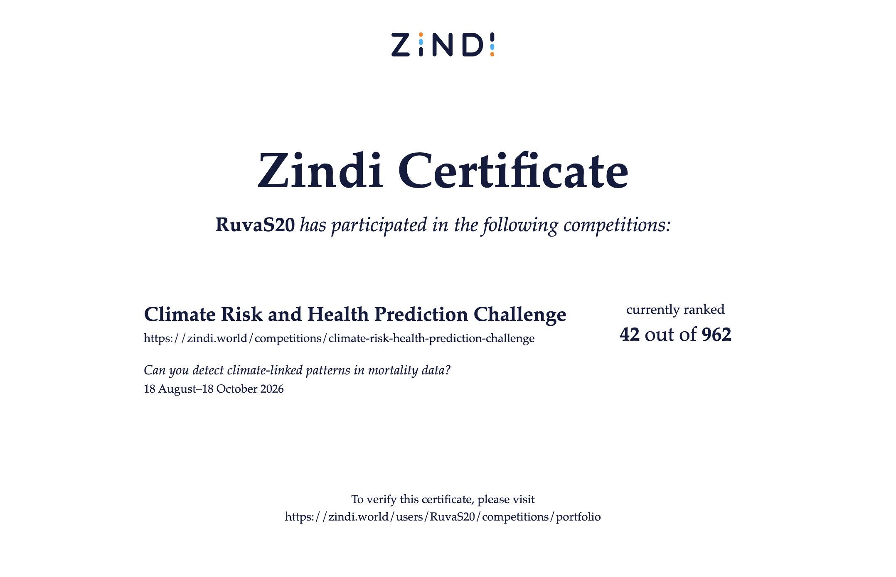

# Climate Risk and Health Prediction Challenge

My work on the [Zindi Climate Risk and Health Prediction Challenge](https://zindi.africa/).

**Code:** [src/climate_health_final.ipynb](src/climate_health_final.ipynb), [src/modelling.py](src/modelling.py), [src/external.py](src/external.py)

## Table of Contents

1. [Overview](#1-overview)
2. [Key Findings](#2-key-findings)
3. [Validation Approach](#3-validation-approach)
4. [Submission Results](#4-submission-results)
5. [What Improved Performance](#5-what-improved-performance)
6. [What Did Not Work](#6-what-did-not-work)
7. [Code Structure](#7-code-structure)
8. [Future Work](#8-future-work)

## 1. Overview

The goal is to predict whether a recorded death in Uganda is climate-sensitive (`is_climate_sensitive`, 0 or 1).

- **Training data:** 3,146 records.
- **Test data:** 1,030 records.
- **Time period:** 2007–2022.
- **Features:** Age, gender, rural or peri-urban zone, death date, location, coordinates, weather, and terrain.
- **Positive class:** About 65% of deaths are labelled climate-sensitive.
- **Evaluation metric:** `0.6 × F1 + 0.4 × ROC-AUC`, with F1 calculated using a fixed probability threshold of 0.5.

The competition prohibits custom threshold selection and AutoML. External data and publicly available pretrained models are allowed but must be disclosed.

## 2. Key Findings

### The test set contains unseen locations

1. Infant deaths labelled climate-sensitive dropped from 97% before 2018 to 56% from 2018 onward. At the same time, infants' share of deaths among children under five increased from about 50% to 90%.

2. Individual climate features have AUC scores between 0.46 and 0.54. A small amount of useful climate-related signal appears among infants recorded before 2018, but it produces only modest improvements.

3. Age and year provide most of the predictive power. Gender also helps, while zone, month, and location have little predictive value on their own.

| Age group | Positive rate |
|---|---:|
| 0 | 79% |
| 1–4 | 92% |
| 5–14 | 68% |
| 15–49 | 51% |
| 50–64 | 41% |
| 65+ | 30% |

4. Ten of the 11 test locations, covering 1,004 of the 1,030 records, do not appear in the training data. None of the test coordinates appear in training either. The split is therefore based on **location rather than time**. I used location-based validation to better reflect this challenge.

## 3. Validation Approach

I used **5-fold `StratifiedGroupKFold`**, grouping records by location. After merging duplicate location names, I had 37 location groups. This ensures that each validation fold contains locations the model has not seen during training, making validation more representative of the test set.

- I used five different fold splits during early experiments and ten splits from submission 7 onward.
- I monitored the predicted-positive rate, aiming for roughly 0.69–0.73 and rejecting models above 0.75.

## 4. Submission Results

| # | Main change | Grouped CV | Public leaderboard |
|---|---|---:|---:|
| 1 | HistGradientBoosting with age and climate features | 0.8000 | 0.8055 |
| 2 | Tuned HistGradientBoosting; added zone and gender | 0.8067 | — |
| 3 | Added ERA5 features and removed weak climate features | 0.8071 | — |
| 4 | HistGradientBoosting + CatBoost ensemble | 0.8208 | 0.8372 |
| **5** | **Tree ensemble + TabPFN v2** | **~0.820** | **0.8414** |
| 6 | Added selected features for pre-2018 infants | 0.8214 | 0.8366 |
| 7 | Tuned HistGradientBoosting over ten splits | 0.8234 | 0.8279 |
| 8 | Averaged submissions 6 and 7 | 0.8226 | — |
| **9** | **Tuned HistGradientBoosting + CatBoost** | **0.8236** | **0.8354** |
| 9b | HistGradientBoosting from submission 9 alone | 0.8233 | 0.8332 |
| 10 | Submission 9 with a different CatBoost blend | 0.8237 | — |

I selected **submissions 5 and 9** as my final candidates.

### Submission 5: Best public leaderboard score

**Features:** `age`, `year`, `post2017`, `under5_post`, `is_rural`, `is_male`.

- `post2017` indicates a death recorded in 2018 or later.
- `under5_post` indicates a child under five recorded in 2018 or later.
- I averaged predictions from three HistGradientBoosting seeds and three CatBoost seeds.
- I blended the tree ensemble with TabPFN v2: 70% tree ensemble and 30% TabPFN v2.
- TabPFN runs on CPU.

**Public leaderboard score: 0.8414.**

### Submission 9: Best cross-validation score

**Features:** Submission 5's features plus `tmin_30d_infant_pre`. This feature contains `tmin_30d` for infants recorded before 2018 and is missing for all other records.

- I averaged predictions from three HistGradientBoosting seeds and three CatBoost seeds.
- Final blend: 70% HistGradientBoosting and 30% CatBoost.
- No external data or pretrained model is used.

## 5. What Improved Performance

| Change | CV improvement | Finding |
|---|---:|---|
| Added age | +0.119 | Biggest improvement by far |
| Added zone and gender | +0.004 | Small but useful gain |
| Increased regularisation | +0.0025 | More regularised trees performed better |
| Added `year` | +0.0135 | Largest gain from a single feature |
| Removed climate features after adding `year` | +0.005 | Climate features partly acted as proxies for time |
| Added selected features for pre-2018 infants | +0.0012 | Small, localised signal |
| Tuned HistGradientBoosting for submission 9 | +0.0020 | Improved all ten validation splits |
| Tuned CatBoost for submission 9 | +0.0027 | Made CatBoost more competitive |
| Blended HistGradientBoosting and CatBoost | +0.0003 | Slightly improved CV and prediction stability |

## 6. What Did Not Work

- Extra age groups and age flags: no meaningful gain.
- Rainfall interactions, ratios, and climate anomalies: no improvement.
- Additional ERA5 weather features: slightly reduced performance.
- Adding more climate features alongside `year`: reduced performance.
- Replacing `year` with a `post2017` flag: reduced performance.
- Training a separate model for adults: reduced performance.
- Removing `year` or `is_male`: reduced performance.
- CHIRPS data: unusable because the server returned incorrect dates.

- **LightGBM:** reduced performance.
- **TabPFN v2:** performed worse alone and usually reduced CV when blended, although it helped form the best public leaderboard submission.
- **Spline logistic regression:** performed worse.
- **Separate adult model:** performed worse.
- **Averaging older models:** did not help.
- **Further hyperparameter tuning:** produced no reliable gains beyond the best settings.

- **Class weighting:** the small gain for one model disappeared in the ensemble and had an effect similar to shifting the classification threshold.
- **Undertrained models:** some produced more positive predictions but had lower AUC and appeared less reliable on unseen locations.
- **Calibration and large sets of engineered features:** did not improve results.

- Many errors came from under-five deaths recorded from 2018 onward, where the infant label distribution changed and the available features offered little way to distinguish the classes.
- Other errors occurred among people aged five and older before 2018.
- For people aged 65+, the model rarely predicted a positive outcome, but the available features had limited ability to distinguish outcomes within this group.

I tested five model types: HistGradientBoosting, CatBoost, LightGBM, TabPFN, and logistic regression. All plateaued around **0.820–0.824 grouped CV**.

## 7. Code structure

- [`src/climate_health_final.ipynb`](src/climate_health_final.ipynb): exploration, validation and a section for each submission, including its features and hyperparameters.
- [`src/modelling.py`](src/modelling.py): handles data loading, grouped cross-validation, experiments, model creation, seed averaging, blending, and submission checks.
- [`src/external.py`](src/external.py): downloads external weather data.

### Seeds and external data

- I use `42` as the base seed and pass explicit seeds to each model. Final blends use seeds `42–44`.
- ERA5/ERA5-Land data from Open-Meteo is cached under `data/external/`. **Neither final candidate uses ERA5.**

## 8. Future Work

- The competition data comes from the [APHRC Climate and Health dataset](https://huggingface.co/datasets/APHRC/Climate_and_Health) on Hugging Face. I'd like to explore it to understand how the `is_climate_sensitive` label is defined, and why the infant labels change so sharply in 2018. That looks like the main reason all my models plateau.

Nonetheless, it was a ride! (I'll start earlier next time, all in a day's work)

